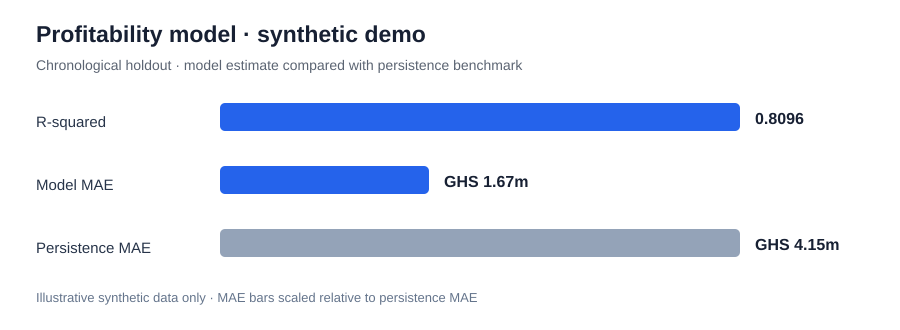

[](https://github.com/Mrroof/bank-profitability-forecasting/actions)

# Bank Profitability Driver Analysis

> **Portfolio case study · Python · pandas · scikit-learn · Matplotlib**

## Executive summary
This project investigates how bank income, funding costs, operating expenses and credit impairment relate to monthly profit before tax. It distinguishes a contemporaneous driver-based estimate from a one-month-ahead forecast that uses lagged information only.

## Business question
How do net interest income, fee income, operating expenses, credit impairment, deposit growth, loan growth, lending yield and deposit cost relate to monthly profit before tax? How much predictive value remains when the model is restricted to information available before the forecast month?

## Demonstration results
The synthetic dataset contains 72 monthly observations. The models were evaluated chronologically, with the final 15 months held out.

| Model | R² | MAE | RMSE | Persistence MAE |
|---|---:|---:|---:|---:|
| Contemporaneous driver nowcast | 0.810 | GHS 1.67m | GHS 1.98m | GHS 4.15m |
| One-month-ahead lagged-driver forecast | 0.291 | GHS 3.26m | GHS 3.81m | GHS 4.15m |

The ex-ante model improves on the persistence MAE by approximately 21%, but its R² is modest. This is a more realistic assessment of the forecasting challenge than relying only on the contemporaneous model, which uses same-month accounting drivers.



## Two different prediction questions
1. **Contemporaneous driver nowcast:** estimates profit using same-month accounting drivers. It is useful only when those drivers are already known or independently estimated.
2. **One-month-ahead forecast:** predicts next month's profit using prior-month profit and prior-month financial drivers. All model inputs are shifted back one month to avoid using information from the forecast period.

Both approaches use chronological train/test splits. The one-month-ahead forecast is compared with a persistence benchmark (last month's profit).

## Workflow
1. Validate and sort monthly records.
2. Fit the contemporaneous driver model on an 80% chronological training window.
3. Create lagged features for profit and each financial driver.
4. Fit a separate one-month-ahead model using lagged features only.
5. Evaluate both approaches using MAE, RMSE and R-squared, and compare each with persistence.
6. Export metrics, forecast predictions, a chart and model notes.

## Run locally
```bash
pip install -r requirements.txt
python src/forecast_profitability.py
```

Generated files are written to `outputs/`, including `model_metrics.csv` and `ex_ante_forecast_predictions.csv`.

## Important limitations
The dataset contains only 72 synthetic monthly observations. Results are illustrative and should not be treated as evidence of live-bank forecasting performance. The lagged model has a small training sample and needs more history, rolling-origin backtesting, residual diagnostics, feature stability checks and comparison with seasonal or statistical time-series baselines before practical use. The dataset does not represent Absa, GCB or any other bank.

## Repository structure

```text
data/bank_profitability_demo.csv   # Synthetic monthly financial drivers
src/forecast_profitability.py      # Nowcast and ex-ante forecast workflow
docs/profitability-metrics.svg     # Model evaluation chart
requirements.txt                    # Python dependencies
.github/workflows/                  # Automated repository validation
```

## Reproducibility

Run the command above from the repository root. The script regenerates metrics, predictions and charts locally in `outputs/`; generated outputs are not committed by default. The GitHub Actions validation workflow checks the project on repository updates.

## Business insights

- The contemporaneous driver nowcast reports **R² 0.810** and **MAE of approximately GHS 1.67m**. However, it uses same-month financial drivers and is not a genuine advance forecast.
- The one-month-ahead lagged-driver model reports **R² 0.291** and **MAE of approximately GHS 3.26m**.
- The persistence benchmark has **MAE of approximately GHS 4.15m**. The lagged model therefore reduces MAE by roughly **21%** on this particular held-out period.
- The gap between the nowcast and the ex-ante forecast illustrates why information availability matters: a strong estimate using current-month accounting data should not be presented as a forecast made before the month begins.

## Practical recommendations

1. Use the contemporaneous model only as a driver-based estimate when same-month inputs are already available or independently forecast.
2. For planning, focus on the one-month-ahead model and compare it with persistence and seasonal/statistical baselines.
3. Extend the history and perform rolling-origin backtesting across multiple forecast windows.
4. Investigate forecast errors around material movements in funding costs, lending yields, impairment and operating expenses.
5. Document when each input becomes available; a forecast is only valid if its features would genuinely be known at the forecast date.
